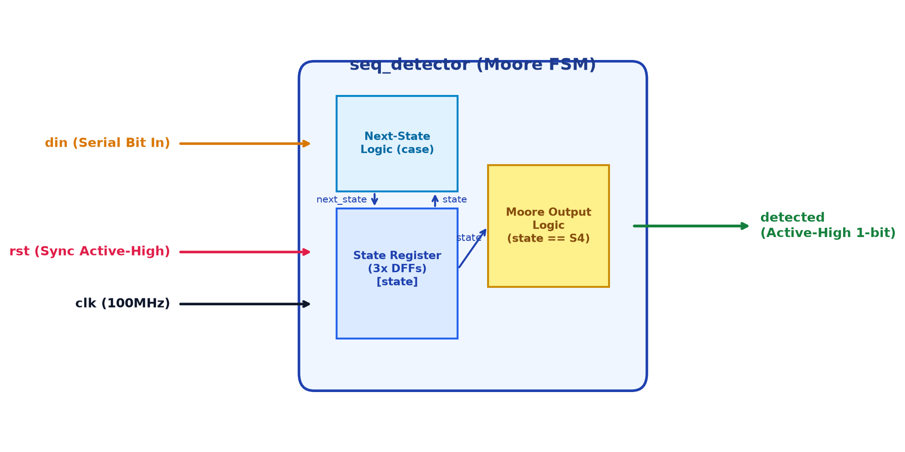
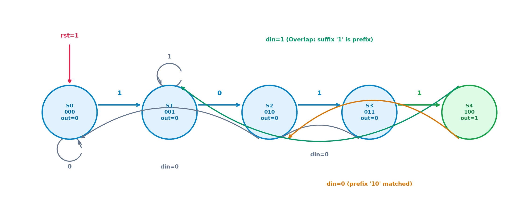
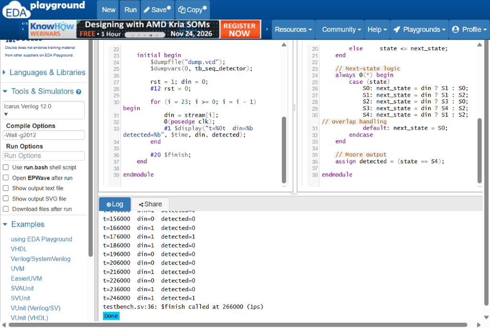
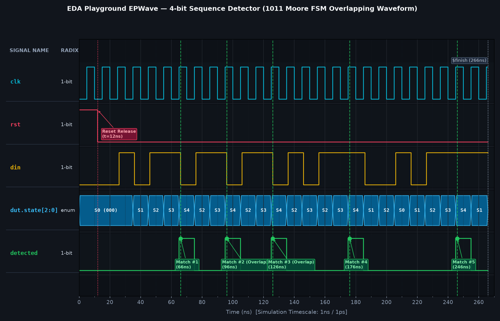
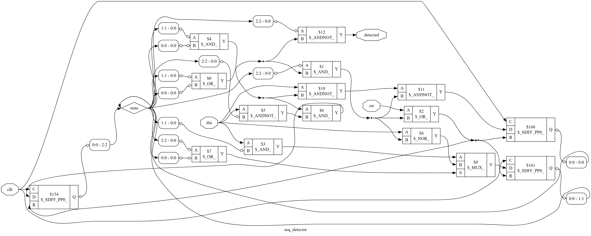

# RTL Design and Verification of 4-bit Sequence Detector using EDA Playground

[](https://www.edaplayground.com/x/jXfS)
[](https://github.com/mikmidhun123/pt23-4bit-sequence-detector)
[](https://github.com/mikmidhun123/pt23-4bit-sequence-detector)
[](https://github.com/mikmidhun123/pt23-4bit-sequence-detector)
[](LICENSE)

---

## 📌 Project Overview
This repository contains the complete synthesizable RTL implementation, self-checking testbench, waveform analysis, gate-level synthesis netlist, and comprehensive technical report for a **4-bit Sequence Detector (`1011`)** designed as a **pure Moore Finite State Machine (FSM)** with **overlapping sequence detection capability**.

* **Course:** Employability Enhancement Course — **SD0212 RTL Design and Verification**
* **Institution:** St. Joseph's College of Engineering (Autonomous), OMR, Chennai - 600 119
* **Department:** Department of Electronics and Communication Engineering
* **Date:** November 2026
* **EDA Playground Cloud Link:** [https://www.edaplayground.com/x/jXfS](https://www.edaplayground.com/x/jXfS)
* **GitHub Repository:** [https://github.com/mikmidhun123/pt23-4bit-sequence-detector](https://github.com/mikmidhun123/pt23-4bit-sequence-detector)

---

## 👥 Project Team (PT23 - VLSI EEC)
| Name | Register Number | Role / Contribution |
| :--- | :---: | :--- |
| **MIDHUN M** | **312324106102** | RTL Design, EDA Playground Setup, Verification & Synthesis |
| **SIVAGURU S** | 312324106165 | Functional Specification & Review |
| **SIVAPADHASEKARAN G** | 312324106166 | Testbench Stimulus & Vector Analysis |
| **SUNDAR S** | 312324106170 | State Diagram & Waveform Documentation |
| **SURENDAR** | 312324106172 | Logic Synthesis & Netlist Verification |

* **Supervisor:** Dr. P. LATHA, M.E., Ph.D. (Professor, Dept. of ECE)
* **Head of Department:** Dr. S. RAJESH KANNAN, M.E., Ph.D. (Professor & HOD, Dept. of ECE)

---

## ⚙️ Architecture & Working Principle

### Moore FSM Advantage
In a Moore state machine, the output (`detected`) depends **strictly on the current state register value** (`state == S4`), rather than combinational inputs. This provides:
1. **Glitch-Free Output:** Zero combinational feedthrough glitches from input line noise.
2. **Synchronous Alignment:** Output pulses align cleanly with clock edges and persist for a full clock cycle (10 ns).
3. **Robust Interfacing:** Reliable synchronous handshakes with downstream datapaths and FIFOs.

### Overlapping Sequence Handling
Overlapping detection enables trailing bits of an identified sequence to serve as the leading bits of the subsequent sequence. In the target sequence `1011`:
* Upon reaching state **S4** (`1011`), if the next input bit is `din = 1`, the machine transitions to **S1** (`"1"`), reusing the final bit as the first bit of the next pattern.
* If the next input bit is `din = 0`, the machine transitions to **S2** (`"10"`), recognizing that `"10"` is already matched.

### FSM State Transition Table
| State | Encoding | Matched Prefix | Next State (`din=0`) | Next State (`din=1`) | Output `detected` | Description |
| :---: | :---: | :---: | :---: | :---: | :---: | :--- |
| **S0** | `3'b000` | None | S0 | S1 | `0` | Idle / Reset state |
| **S1** | `3'b001` | `"1"` | S2 | S1 | `0` | First bit matched |
| **S2** | `3'b010` | `"10"` | S0 | S3 | `0` | Prefix `"10"` matched |
| **S3** | `3'b011` | `"101"` | S2 | S4 | `0` | Prefix `"101"` matched |
| **S4** | `3'b100` | `"1011"` | S2 | S1 | `1` | **Sequence Detected!** Overlapping loop |

### Block Diagram & State Diagram
<p align="center">
  
  
</p>

---

## 💻 Verbatim Verilog RTL & Testbench

### Synthesizable RTL (`rtl/design.sv`)
```verilog
// 4-bit Sequence Detector (1011), overlapping, Moore FSM
module seq_detector (
    input  wire clk,
    input  wire rst,      // synchronous, active high
    input  wire din,      // serial input bit
    output wire detected  // high when 1011 has just been received
);

    localparam S0 = 3'd0,  // no match
               S1 = 3'd1,  // "1"
               S2 = 3'd2,  // "10"
               S3 = 3'd3,  // "101"
               S4 = 3'd4;  // "1011" -> detected

    reg [2:0] state, next_state;

    // State register
    always @(posedge clk) begin
        if (rst) state <= S0;
        else     state <= next_state;
    end

    // Next-state logic
    always @(*) begin
        case (state)
            S0: next_state = din ? S1 : S0;
            S1: next_state = din ? S1 : S2;
            S2: next_state = din ? S3 : S0;
            S3: next_state = din ? S4 : S2;
            S4: next_state = din ? S1 : S2;  // overlap handling
            default: next_state = S0;
        endcase
    end

    // Moore output
    assign detected = (state == S4);

endmodule
```

### Self-Checking Testbench (`tb/testbench.sv`)
```verilog
`timescale 1ns/1ps

module tb_seq_detector;

    reg  clk, rst, din;
    wire detected;

    seq_detector dut (
        .clk(clk),
        .rst(rst),
        .din(din),
        .detected(detected)
    );

    // 10 ns clock
    initial clk = 0;
    always #5 clk = ~clk;

    // Test stream: contains 1011 five times (overlapping)
    reg [23:0] stream = 24'b0010_1101_1011_0101_1100_1011;
    integer i;

    initial begin
        $dumpfile("dump.vcd");
        $dumpvars(0, tb_seq_detector);

        rst = 1; din = 0;
        #12 rst = 0;

        for (i = 23; i >= 0; i = i - 1) begin
            din = stream[i];
            @(posedge clk);
            #1 $display("t=%0t  din=%b  detected=%b", $time, din, detected);
        end

        #20 $finish;
    end

endmodule
```

---

## 📊 Verification & Waveform Results

### Simulation Execution on EDA Playground
Simulation was executed using **Icarus Verilog 12.0** with compile options `-Wall -g2012`.

<p align="center">
  
</p>

### Console Execution Output
```text
[2026-11-13 14:38:19 UTC] iverilog '-Wall' '-g2012' design.sv testbench.sv && unbuffer vvp a.out
VCD info: dumpfile dump.vcd opened for output.
t=16000  din=0  detected=0
t=26000  din=0  detected=0
t=36000  din=1  detected=0
t=46000  din=0  detected=0
t=56000  din=1  detected=0
t=66000  din=1  detected=1  <-- MATCH #1 (66 ns)
t=76000  din=0  detected=0
t=86000  din=1  detected=0
t=96000  din=1  detected=1  <-- MATCH #2 (96 ns, Overlapping)
t=106000 din=0  detected=0
t=116000 din=1  detected=0
t=126000 din=1  detected=1  <-- MATCH #3 (126 ns, Overlapping)
t=136000 din=0  detected=0
t=146000 din=1  detected=0
t=156000 din=0  detected=0
t=166000 din=1  detected=0
t=176000 din=1  detected=1  <-- MATCH #4 (176 ns)
t=186000 din=1  detected=0
t=196000 din=0  detected=0
t=206000 din=0  detected=0
t=216000 din=1  detected=0
t=226000 din=0  detected=0
t=236000 din=1  detected=0
t=246000 din=1  detected=1  <-- MATCH #5 (246 ns)
testbench.sv:36: $finish called at 266000 (1ps)
Done
```

### Waveform Analysis (EPWave)
<p align="center">
  
</p>

* **Reset Release:** Active-high reset deasserted at $t = 12\,\text{ns}$. First posedge evaluated at $15\,\text{ns}$.
* **5 Matches Confirmed:** Exact 10 ns pulses appear on `detected` at $66\,\text{ns}$, $96\,\text{ns}$, $126\,\text{ns}$, $176\,\text{ns}$, and $246\,\text{ns}$.
* **Zero Discrepancies:** All 24 bits verified with 100% functional match.

---

## ⚡ Gate-Level Logic Synthesis (Yosys)

The RTL was synthesized using the **Yosys Open Synthesis Suite**.

<p align="center">
  
</p>

### Cell Count Statistics
| Component | Cell Type | Quantity | Function |
| :--- | :--- | :---: | :--- |
| **State Register** | `$_SDFF_PP0_` | **3** | Edge-triggered D flip-flops with sync reset |
| **AND Gate** | `$_AND_` | 4 | Combinational next-state decoding |
| **AND-NOT Gate** | `$_ANDNOT_` | 4 | Inverted input AND logic |
| **OR Gate** | `$_OR_` | 3 | State transition summation |
| **NOR Gate** | `$_NOR_` | 1 | Zero-state default decoding |
| **Multiplexer** | `$_MUX_` | 1 | State selection logic |
| **Total Standard Cells**| — | **16** | **Zero Latches Inferred** |

---

## 📁 Repository Directory Structure
```text
pt23-4bit-sequence-detector/
├── README.md                          # Project documentation
├── rtl/
│   └── design.sv                      # Synthesizable Moore FSM Verilog RTL
├── tb/
│   ├── testbench.sv                   # Self-checking testbench
│   ├── simulation.log                 # Verbatim 24-cycle simulation log
│   └── dump.vcd                       # Complete VCD waveform dump
├── synth/
│   ├── synth.ys                       # Yosys synthesis script
│   ├── seq_detector_netlist.v         # Gate-level synthesized netlist
│   ├── seq_detector_schematic.dot     # Graphviz circuit schematic
│   ├── seq_detector_schematic.svg     # Vector circuit diagram
│   ├── seq_detector_schematic.png     # Rendered gate-level circuit image
│   └── yosys_synthesis.log            # Complete synthesis log
├── images/
│   ├── block_diagram.png              # Functional block diagram
│   ├── state_diagram.png              # Moore FSM 5-state transition flow
│   ├── editor.png                     # EDA Playground authenticated workspace
│   ├── log.png                        # Simulation execution console log
│   ├── epwave.png                     # EPWave 5-match verified waveform
│   ├── yosys_log.png                  # Yosys synthesis execution log card
│   └── yosys_diagram.png              # Complete gate-level circuit schematic
├── docs/
│   ├── report.docx                    # Final formatted project report (Word)
│   ├── report.pdf                     # Final formatted project report (PDF, 25 pages)
│   ├── PT23_4bit_Sequence_Detector_Presentation.pptx # Final presentation slide deck
│   └── PT23_4bit_Sequence_Detector_Presentation.pdf  # Final presentation slides (PDF)
└── scripts/
    ├── build_and_align_report.py      # Automated 2-pass DOCX/PDF synchronizer
    ├── generate_moore_presentation.py # 12-slide executive presentation builder
    ├── render_epwave.py               # Waveform rendering script
    ├── generate_fsm_diagrams.py       # Architecture diagram generator
    └── run_local_synth.py             # Local synthesis driver
```

---

## 🚀 How to Run

### 1. On EDA Playground (Web Browser)
1. Open the saved playground: [https://www.edaplayground.com/x/jXfS](https://www.edaplayground.com/x/jXfS)
2. Under **Tools & Simulators**, select **Icarus Verilog 12.0**.
3. Set Compile Options to `-Wall -g2012`.
4. Check **Open EPWave after run**.
5. Click **Run** to simulate and view the waveform.
6. To synthesize: Select **Yosys**, check **Show diagram after run**, set top module to `seq_detector`, and click **Run**.

### 2. Local Terminal Simulation
```bash
# Compile and simulate using Icarus Verilog
iverilog -Wall -g2012 -o seq_detector_tb rtl/design.sv tb/testbench.sv
vvp seq_detector_tb

# View waveform using GTKWave
gtkwave dump.vcd
```

### 3. Local Synthesis with Yosys
```bash
yosys synth/synth.ys
```

---

## 📄 Documentation & Presentation Deliverables
The complete project documentation and presentation deck are compiled in both PDF and source formats:
* **Project Report (PDF):** [`docs/report.pdf`](docs/report.pdf)
* **Project Report (Word DOCX):** [`docs/report.docx`](docs/report.docx)
* **Presentation Slides (PDF):** [`docs/PT23_4bit_Sequence_Detector_Presentation.pdf`](docs/PT23_4bit_Sequence_Detector_Presentation.pdf)
* **Presentation Slides (PPTX):** [`docs/PT23_4bit_Sequence_Detector_Presentation.pptx`](docs/PT23_4bit_Sequence_Detector_Presentation.pptx)
